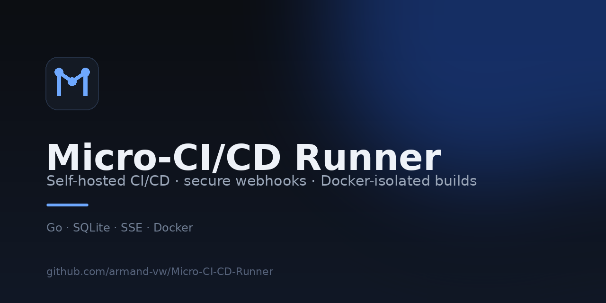

<div align="center">
  
  <h1>Micro-CI/CD Runner</h1>
  <p><strong>A lightweight, self-hosted CI/CD runner with secure GitHub webhooks, Docker-isolated builds, SQLite history, and a real-time dashboard.</strong></p>

  [](https://github.com/armand-vw/Micro-CI-CD-Runner/actions/workflows/ci.yml)
  [](https://github.com/armand-vw/Micro-CI-CD-Runner/actions/workflows/codeql.yml)
  [](https://pkg.go.dev/github.com/armand-vw/Micro-CI-CD-Runner)
  [](go.mod)
  [](LICENSE)
  [](https://github.com/armand-vw/Micro-CI-CD-Runner/releases)
</div>



---

## Why another CI runner?

Most CI systems are excellent and also far larger than a homelab, a side project,
or a small team needs. Micro-CI/CD Runner is intentionally small:

- **One static binary** serves the webhook listener, REST API, SSE stream, and dashboard.
- **No external queue, broker, or database server** — SQLite is enough.
- **Real Docker isolation** with resource limits, dropped capabilities, and an ephemeral workspace.
- **No vendor lock-in** — self-host it, own the data, read every line.

It is not trying to replace GitHub Actions at scale. It is a focused runner for
people who want a public webhook endpoint, a container per build, and a clean
dashboard without operating a platform.

## Features

- Secure GitHub push webhooks with **HMAC-SHA256 signature verification** (constant-time compare).
- **Idempotent ingestion** using the GitHub delivery ID, so retries do not duplicate builds.
- Container-per-build execution through the Docker/Moby SDK.
- Configurable image, branch, setup command, and test command per project.
- Hardened build containers: dropped capabilities, `no-new-privileges`, memory/CPU/PID limits, read-only-free ephemeral `tmpfs` workspace, and a hard timeout.
- SQLite build history with status transitions, timestamps, and bounded logs.
- **Server-Sent Events** dashboard updates with automatic reconnect and polling fallback.
- Responsive light/dark dashboard embedded in the binary.
- Graceful shutdown, stale-container cleanup, and orphaned-build recovery.
- Optional admin token for retries and CORS allowlist for a statically hosted UI.

## Architecture

```
GitHub push
    │  HTTPS POST /webhook (HMAC-SHA256)
    ▼
┌─────────────────────────────────────────────────────────────┐
│ Micro-CI/CD Runner (single Go binary)                        │
│                                                             │
│  webhook ──▶ SQLite (projects, builds) ◀── REST API         │
│     │                 │                        │            │
│     └──▶ bounded queue ──▶ worker ──▶ Docker SDK            │
│                                  │             │            │
│                                  ▼             ▼            │
│                        isolated build container   SSE bus   │
│                        (git clone + test)         │         │
│                                                   ▼         │
│                                        embedded dashboard   │
└─────────────────────────────────────────────────────────────┘
```

The webhook responds as soon as a build is queued. Logs stream from the
container to SQLite and to the dashboard simultaneously. See
[docs/architecture.md](docs/architecture.md) for the full design.

## Quick start

### Prerequisites

- A host with Docker Engine (the runner needs access to the Docker socket).
- A public HTTPS URL for GitHub to deliver webhooks. A VPS or a tunnel such as
  Cloudflare Tunnel works well.
- Go 1.26+ only if you want to build from source; Docker Compose is enough to run it.

### 1. Configure

```bash
git clone https://github.com/armand-vw/Micro-CI-CD-Runner.git
cd Micro-CI-CD-Runner

cp .env.example .env
# Generate a strong secret and put it in .env as GITHUB_WEBHOOK_SECRET
openssl rand -hex 32
```

Edit `config/projects.yaml` if you want to build your own repositories. The
checked-in entry builds this project's own test suite on pushes to `main` using
`golang:1.27-alpine`.

### 2. Run

```bash
docker compose -f deploy/docker-compose.yml up -d --build
```

Open <http://localhost:8080>. The dashboard is served by the runner itself.

### 3. Configure the GitHub webhook

In your repository: **Settings → Webhooks → Add webhook**

| Field | Value |
| --- | --- |
| Payload URL | `https://ci.example.com/webhook` |
| Content type | `application/json` |
| Secret | the same `GITHUB_WEBHOOK_SECRET` |
| SSL verification | enabled |
| Events | **Just the push event** |

For local testing behind NAT, expose the runner with a tunnel, for example:

```bash
cloudflared tunnel --url http://localhost:8080
# Use https://<tunnel-host>/webhook as the payload URL.
```

Push a commit. A build appears as **pending**, moves to **running**, and streams
logs live before ending as **success** or **failed**.

## Configuration

All configuration is environment based. See [`.env.example`](.env.example) and
[docs/configuration.md](docs/configuration.md).

| Variable | Default | Description |
| --- | --- | --- |
| `PORT` | `8080` | HTTP listen port. |
| `DB_PATH` | `./data/runner.db` | SQLite database path. |
| `PROJECTS_FILE` | `./config/projects.yaml` | Project definitions. |
| `GITHUB_WEBHOOK_SECRET` | **required** | Webhook HMAC secret. |
| `GITHUB_TOKEN` | empty | Optional token for private repositories. |
| `DOCKER_HOST` | SDK default | Docker daemon endpoint. |
| `MAX_CONCURRENT_BUILDS` | `1` | Build workers. |
| `QUEUE_SIZE` | `100` | Bounded build queue. |
| `BUILD_TIMEOUT` | `15m` | Hard per-build timeout. |
| `LOG_MAX_BYTES` | `2097152` | Log cap per build. |
| `ADMIN_TOKEN` | empty | Bearer token for retries. |
| `ALLOWED_ORIGINS` | empty | CORS allowlist for a remote UI. |
| `LOG_LEVEL` | `info` | `debug`, `info`, `warn`, `error`. |

### Project definitions

```yaml
projects:
  - name: my-app
    repo_url: https://github.com/owner/my-app
    branch: main          # or "*" to build every branch
    image: node:20-alpine
    setup_command: apk add --no-cache git
    test_command: npm ci && npm test
```

Projects are upserted by `repo_url` at startup. `setup_command` runs before the
clone, which is useful for installing `git` in slim Alpine images.

## API

| Method | Path | Description |
| --- | --- | --- |
| `POST` | `/webhook` | GitHub push events (HMAC verified). |
| `GET` | `/healthz` | Liveness/readiness probe. |
| `GET` | `/api/projects` | Registered projects. |
| `GET` | `/api/stats` | Aggregate build counts. |
| `GET` | `/api/builds` | Build list (`project_id`, `status`, `limit`, `offset`). |
| `GET` | `/api/builds/{id}` | Build details. |
| `GET` | `/api/builds/{id}/logs` | Plain-text logs (`?download=1`). |
| `POST` | `/api/builds/{id}/retry` | Queue a retry (admin token if configured). |
| `GET` | `/api/events` | SSE stream of build updates and log chunks. |

Full details: [docs/api.md](docs/api.md).

## Dashboard

The dashboard is plain HTML/CSS/JavaScript, embedded into the binary, and needs
no build step. It includes:

- Project sidebar with the latest status per project.
- Overview cards for total, running, successful, and failed builds.
- Filterable build history with commit and branch metadata.
- A build drawer with live logs, autoscroll, download, and retry.
- Light/dark themes and a live-connection indicator.

The same `web/` directory can be published to GitHub Pages as a static demo.
Because GitHub Pages cannot run the backend, live data requires a publicly
reachable runner, a configured `apiBase`, and CORS. See
[docs/github-pages.md](docs/github-pages.md).

## Security highlights

- Webhook signatures are verified in constant time before any JSON parsing.
- Payloads are capped at 1 MiB and delivery IDs make ingestion idempotent.
- Build containers drop all capabilities, forbid privilege escalation, and run
  with memory, CPU, PID, workspace, and log limits.
- The Docker socket is **never** mounted into build containers.
- Build commands come only from the trusted `projects.yaml`.
- The runner itself has root-equivalent access through the Docker socket. Treat
  its API as an admin surface and put it behind HTTPS and authentication.

Read [SECURITY.md](SECURITY.md) before exposing the runner to the internet.

## Development

```bash
make tidy      # resolve modules
make fmt       # gofmt
make vet       # go vet
make test      # go test ./...
make test-race # race detector (requires a C compiler)
make build     # build bin/runner
make run       # run locally (requires Docker + .env)

make docker    # build the container image
make compose-up
```

The dashboard lives in [`web/`](web) and is embedded with `go:embed`.

## Roadmap

- Per-repository pipeline definitions (`.microci.yml`).
- Build cancellation from the dashboard.
- Artifact collection and retention policies.
- Metrics endpoint (Prometheus) and structured audit logs.
- Optional Postgres backend for multi-node deployments.

Ideas and pull requests are welcome.

## Contributing

Please read [CONTRIBUTING.md](CONTRIBUTING.md) and
[CODE_OF_CONDUCT.md](CODE_OF_CONDUCT.md). Security issues should follow
[SECURITY.md](SECURITY.md), not the public issue tracker.

## License

Released under the [MIT License](LICENSE).
